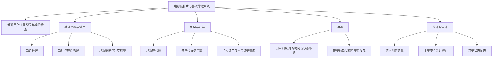
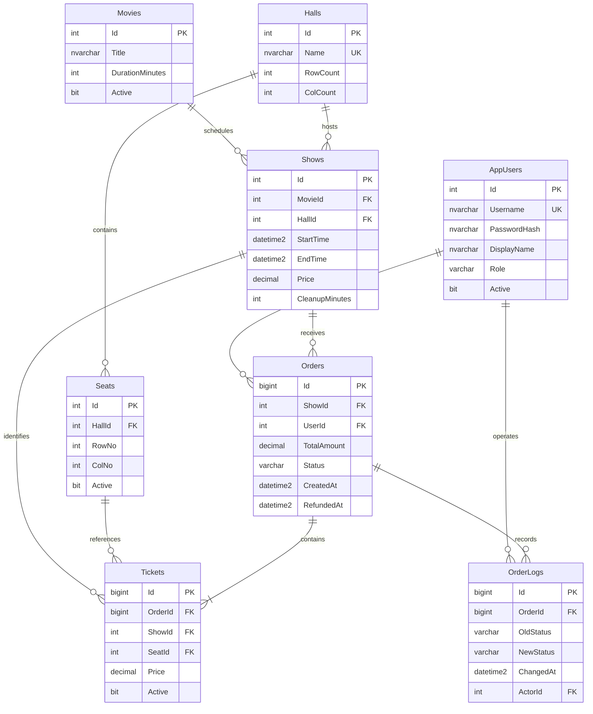
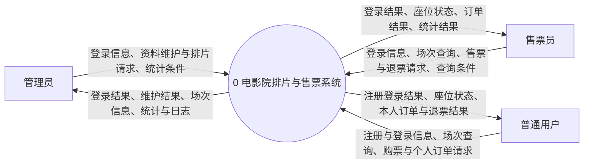
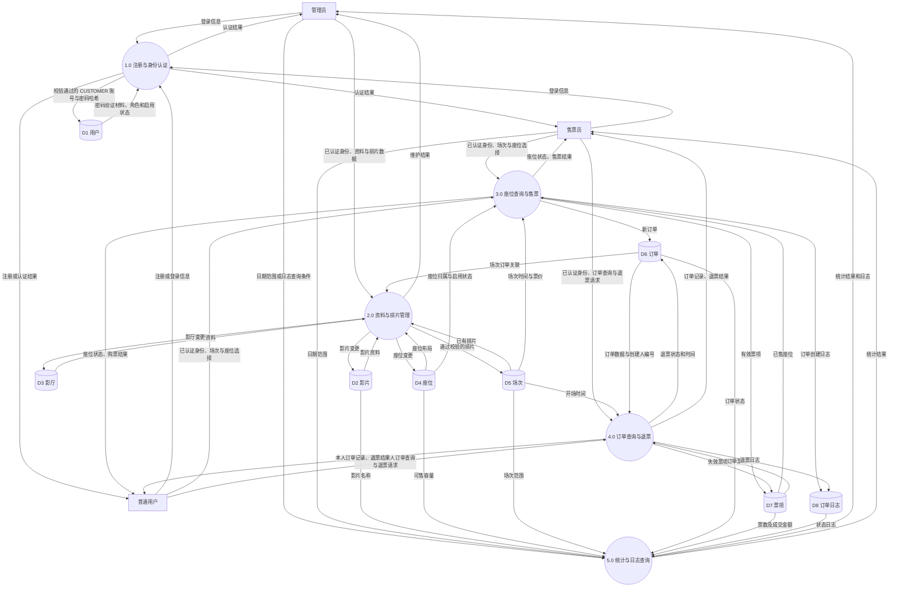
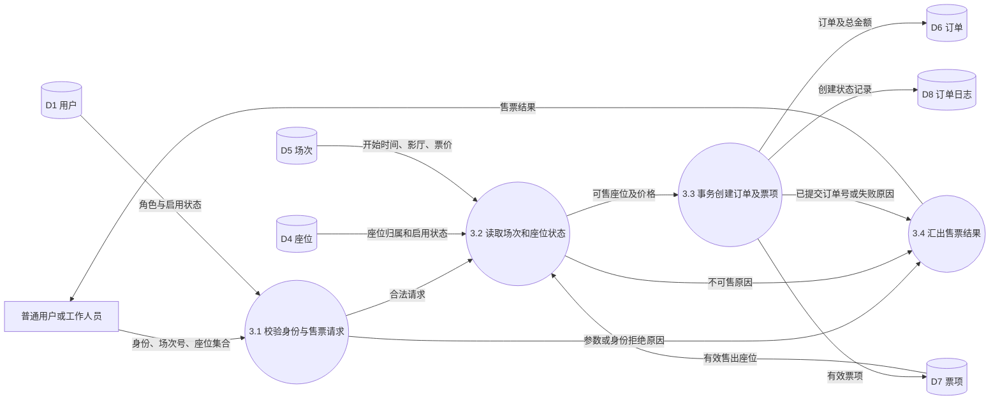
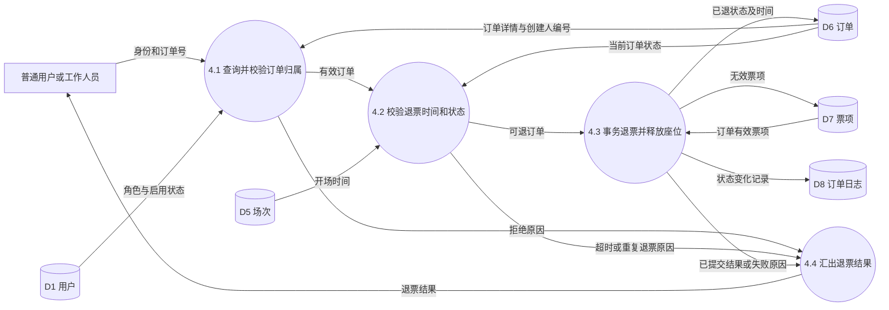

# 电影院排片与售票管理系统设计说明

本文是项目开发阶段的设计底稿，用于说明业务范围、数据库结构和核心处理流程。完成开发后，应依据实际代码、测试结果和分工继续修订，再分别编写个人课程设计报告。

## 1 项目范围

本系统面向单个电影院的管理员、售票员和普通用户，采用 Java Swing 桌面界面和 SQL Server 数据库。普通用户可以注册登录、自主选座购票、查询个人订单和整单退票；工作人员负责影片与影厅管理、排片、柜台售票、订单处理和经营统计。付款为模拟确认，不连接真实支付平台。普通用户是本次系统扩展，按用户要求不修改原课程设计任务书。

系统重点解决以下问题：

- 同一影厅的场次在影片放映及散场清理期间不能重叠。
- 同一场次的同一个座位不能被有效售出两次。
- 多个座位在一次售票中组成一张订单，全部成功或全部失败。
- 开场前可整单退票，订单和全部票项一起改变状态，座位重新可售。
- 历史订单和退票记录保留，票房与上座率计算可以追溯。
- 普通用户只能查询、退还本人订单；工作人员按角色处理影院业务，数据库约束、事务、存储过程和触发器均有具体用途。

本阶段不包含会员积分、折扣券、真实支付、互联网部署、跨影院调度和部分退票。普通用户在同一个本地桌面程序中自助购票。未购买前的界面选座也不等同于占座；提交售票时由数据库最终裁定是否可售。

## 2 角色与分工建议

| 角色 | 允许的业务操作 |
| --- | --- |
| 管理员 ADMIN | 影片、影厅、座位和场次维护；售票、退票、订单查询、统计与日志查看 |
| 售票员 CASHIER | 查看场次和座位；售票、整单退票、订单查询及经营统计 |
| 普通用户 CUSTOMER | 注册登录、浏览影片与未来场次、自主选座购票、查询及退还本人订单、修改密码 |

管理员和售票员可以处理全影院订单，包括其他售票员或普通用户创建的订单。普通用户没有基础资料维护、排片、经营统计和日志权限。`Orders.UserId` 保存创建订单的应用账号：柜台售票时为操作员，自主购票时为本人；当前不提供柜台替指定注册用户绑定订单的功能。

公开注册入口只创建 `CUSTOMER`，不接收角色选择。账号为 3–30 位英文字母、数字或下划线；显示名称为 1–50 字；密码为 10–128 位，确认密码由界面检查。用户名唯一，密码以带盐 PBKDF2 结果保存。登录后界面根据角色显示功能，业务服务仍校验角色与账号状态，不能只靠隐藏菜单限制访问。

以下是模块负责人建议，不代表这些工作已经由相应成员完成。实际课程报告应填写真实完成情况。

| 成员 | 主要模块 | 需要与其他成员共同确认的事项 |
| --- | --- | --- |
| 陈仓宜 | 影片、影厅、座位、场次维护和排片冲突检查 | 表结构、场次时间边界、已关联数据的删除限制 |
| 孙浩文 | 座位图、选座售票、订单生成和并发售票 | 订单状态、存储过程返回值、重复售座和回滚测试 |
| 刘先旭 | 退票、经营统计、权限和订单日志 | 退票条件、统计口径、权限矩阵和日志内容 |

数据库总体结构、接口约定、系统联调和最终验收由三人共同参与。代码可通过 GitHub 仓库提交，每次提交写明具体修改内容；真实讨论记录、评审意见与提交记录可以共同作为协作过程的依据。

## 3 系统结构

界面通过业务服务访问 JDBC。业务服务负责身份校验、角色限制、参数校验和查询；关键写操作调用存储过程。数据库保存业务数据，并以外键、检查约束、唯一索引、事务和日志触发器保证关键规则。

这是运行在可信本机环境中的课程演示系统。应用登录不等同于为每个用户建立独立的 SQL Server 登录：存储过程接收的操作员编号由应用传入，数据库检查该编号对应的角色和启用状态。持有应用数据库凭据的人可能绕过桌面应用调用数据库，因此不能把这套身份机制直接作为公网服务的安全边界。实际部署需要进一步隔离数据库凭据并使用可信服务端验证身份。

## 4 核心业务规则

### 4.1 排片

一个场次保存开始时间、结束时间、票价及散场间隔。创建场次时，以影片时长计算并保存结束时间，形成该场次的时间快照。

同一影厅两个场次的占用区间分别为 `[开始时间, 结束时间 + 散场间隔)`。只要区间重叠就拒绝排片；前一场占用结束时刻与后一场开始时刻相等时，可以衔接。排片创建与修改需要串行检查同一影厅，避免两个操作同时检查通过后插入冲突场次。

不允许创建过去的场次，也不允许修改已开始的场次。已经产生任何订单的场次不允许修改或删除，以免历史票价、影片、座位归属和交易记录失去依据。影片停用不等于删除历史记录。

### 4.2 影厅与座位

每个座位属于一个影厅，同一影厅的行号和列号组合唯一。新建影厅时按行列数生成座位。已有场次的影厅不允许调整行列布局；座位启用状态也采用保守限制，已有场次后不再随意变更。这样可以避免票据关联和统计容量发生隐式变化。

影厅、影片等数据只有在没有关联业务记录时才允许删除。存在关联时应保留记录，使用停用或业务限制处理，而不是级联删除历史订单。

### 4.3 售票

售票前检查已登录账号、场次、开始时间和座位集合。普通用户和工作人员使用同一事务售票流程，由登录身份确定订单创建人，不允许在购票界面指定其他用户编号。座位集合不得为空，不能包含重复编号、未知座位、停用座位或其他影厅的座位。

每张订单对应一个场次，可以购买多个座位。票项保存购买时的单价快照，订单总额等于票项单价之和。整笔售票在同一事务中完成，不允许部分座位售出而另一些失败。

`Tickets` 对有效票项建立 `(ShowId, SeatId)` 过滤唯一索引，即 `Active = 1` 时同场同座只能存在一张有效票。场次级并发锁与唯一索引共同防止重复售座。界面读取的座位图可能已经过时，提交时必须重新校验。

### 4.4 退票

订单状态包括 `PAID`（已售）和 `REFUNDED`（已退）。只允许在场次开始前，对 `PAID` 订单执行整单退票。到达开始时刻即不再允许退票。普通用户的请求还必须满足订单 `UserId` 等于当前账号编号；该归属检查在退票存储过程中执行，即使传入其他人的订单编号也不能退票。工作人员保留全影院退票权限。

退款为模拟业务：系统改变订单状态、记录退票时间、将该订单全部票项置为无效，不执行真实资金转账。操作必须在同一事务中完成。历史票项不删除，座位因有效票项解除而重新可售；之后可以生成新订单再次出售。

重复退票、对不存在或无权处理的订单退票、开场后退票均应失败，并保持原有数据不变。

### 4.5 日志

订单创建或状态变化由触发器生成日志。日志记录订单编号、旧状态、新状态、发生时间和操作员。一次失败并回滚的业务不应留下已提交的成功状态日志。普通订单查询不产生状态变化日志。

### 4.6 日期与统计口径

订单查询按订单创建日期筛选；普通用户查询同时强制按当前账号的 `Orders.UserId` 筛选，工作人员查询全影院订单。经营统计仅供工作人员使用，按场次开始日期筛选。输入起止日期时，两端日期均包含在内，数据库查询转换为“起日零时至末日次日零时”的半开区间。

| 指标 | 定义 |
| --- | --- |
| 场次数 | 范围内的场次总数，包括零售票场次 |
| 累计售票数 | 所选场次曾产生的票项数量，包括后来退票的票项 |
| 退票数 | 所选场次中已失效的退票票项数量 |
| 有效售票数 | 当前仍有效的票项数量 |
| 净票房 | 当前有效票项的成交单价之和，不使用影片或场次的现价反推 |
| 可售容量 | 所选各场次所属影厅的可售座位数量之和 |
| 上座率 | 有效售票数 ÷ 可售容量 × 100%；容量为零时显示 0 |

影片排行按净票房降序排列。多个场次的上座率应使用总有效票数除以总容量，不能直接平均各场次的百分比。所选场次的后续退票会改变其净票房统计；这不是按收付款发生日编制的财务流水报表。

## 5 数据库关系图

图中展示业务主字段；SQL 脚本中为支持组合外键或审计补充的字段，以实际建表定义为准。`Tickets.ShowId` 与订单场次保持一致，座位必须属于场次所在影厅。不能仅依赖独立外键保证这两条跨表规则。

## 6 数据字典

### 6.1 数据存储

| 编号 | 数据存储 | 主要用途 | 关键完整性规则 |
| --- | --- | --- | --- |
| D1 | AppUsers | 登录身份、显示名称、角色、启用状态 | 用户名唯一；角色限定 ADMIN/CASHIER/CUSTOMER；注册只创建 CUSTOMER；不保存明文密码 |
| D2 | Movies | 影片名称、时长、启用状态 | 片长为正整数；已被场次引用时禁止直接删除 |
| D3 | Halls | 影厅名称和布局尺寸 | 名称唯一；行列数在允许范围内 |
| D4 | Seats | 座位所属影厅、行列号及可售状态 | 同厅行列组合唯一；行列为正数 |
| D5 | Shows | 影片、影厅、放映时间、票价、散场间隔 | 结束晚于开始；票价非负；间隔非负；同厅时间不冲突 |
| D6 | Orders | 场次、订单创建人、总金额、订单状态和时间 | 状态限定；场次和创建人存在；普通用户查询和退票需检查归属；总金额为正 |
| D7 | Tickets | 订单中的座位、场次、成交单价和有效状态 | 同场同座有效票唯一；座位与场次影厅一致；与订单场次一致 |
| D8 | OrderLogs | 订单状态变化及操作人 | 订单和操作员存在；由触发器随业务事务写入 |

### 6.2 主要数据项

| 数据项 | 类型 | 含义及约束 |
| --- | --- | --- |
| Id | int / bigint | 数据库生成的主键；订单、票项、日志使用 bigint |
| Username | 字符串 | 用户登录名，与显示姓名不同 |
| PasswordHash | 字符串 | PBKDF2 密码验证材料，包含盐值和派生结果等信息；不用于界面展示 |
| Role | 枚举字符串 | ADMIN、CASHIER 或 CUSTOMER |
| Orders.UserId | int | 订单创建人；自主购票为普通用户本人，柜台售票为操作员，关联 AppUsers.Id |
| Active | bit | 根据表含义表示账户/影片/座位启用，或票项仍然有效 |
| DurationMinutes | int | 影片片长，单位分钟 |
| RowCount / ColCount | int | 影厅座位布局尺寸 |
| RowNo / ColNo | int | 座位在影厅中的位置，界面从 1 开始显示 |
| StartTime / EndTime | datetime2 | 场次开始和结束时间，使用本机与数据库一致的本地时间约定 |
| CleanupMinutes | int | 场次结束后的清场间隔，单位分钟 |
| Price | decimal(10,2) | 场次票价或票项成交单价，避免二进制浮点误差 |
| TotalAmount | decimal | 订单成交总额，精度以建表脚本为准 |
| Status | 枚举字符串 | PAID 或 REFUNDED |
| CreatedAt | datetime2 | 订单创建时间 |
| RefundedAt | datetime2，可空 | 成功退票时间，未退票为空 |
| OldStatus | 字符串，可空 | 变更前的订单状态；初始创建日志可为空 |
| NewStatus | 字符串 | 本次变更后的订单状态 |
| ActorId | int | 执行此次变更的操作员编号 |

### 6.3 主要数据流

| 数据流 | 组成 | 来源与去向 |
| --- | --- | --- |
| 登录信息 | 用户名、密码 | 用户 → 身份认证 |
| 注册信息 | 用户名、显示名称、密码 | 普通用户 → 注册校验；服务端固定 CUSTOMER 角色 |
| 注册结果 | 新账号身份或拒绝原因 | 注册处理 → 普通用户界面 |
| 登录结果 | 用户编号、姓名、角色或失败原因 | 身份认证 → 用户界面 |
| 排片请求 | 操作员、影片、影厅、开始时间、票价、散场间隔 | 管理员 → 排片处理 |
| 座位查询 | 场次编号 | 普通用户或工作人员 → 座位查询 |
| 座位状态 | 座位编号、行列、是否可售、是否已售 | 座位查询 → 普通用户或工作人员 |
| 售票请求 | 已认证账号、场次编号、座位编号集合 | 普通用户或工作人员 → 售票处理 |
| 售票结果 | 订单号、金额或拒绝原因 | 售票处理 → 普通用户或工作人员 |
| 订单查询条件 | 已认证账号、起止日期 | 普通用户或工作人员 → 按权限查询订单 |
| 退票请求 | 已认证账号、订单号 | 普通用户或工作人员 → 归属与退票校验 |
| 退票结果 | 订单号、状态或拒绝原因 | 退票处理 → 普通用户或工作人员 |
| 统计条件 | 起始日期、结束日期 | 工作人员 → 经营统计 |
| 统计结果 | 影片、场次、票数、净票房、容量、上座率 | 经营统计 → 工作人员 |

## 7 数据流图

以下图使用“外部实体—处理—数据存储”的方式描述数据流，箭头表示数据内容，不表示按钮点击顺序。数据流图与前述功能模块图用途不同。

### 7.1 顶层图 0 层

管理员也可以执行售票员业务，图中省略重复箭头以保持清晰。

### 7.2 第一层分解图

第一层中的写入日志表示业务处理产生的数据，实际由 SQL Server 触发器执行，而不是 Java 再写一遍。各处理所需的操作员启用状态和角色检查属于其输入校验，图中不重复绘制所有 D1 读取箭头。

### 7.3 第二层分解图 3.0 售票

3.2 与 3.3 的关键检查和写入位于同一受锁保护的事务中，不能理解成先在事务外读一次再无条件写入。唯一索引是最终防重复售座的约束。失败时订单、票项及日志一起回滚。

### 7.4 第二层分解图 4.0 退票

## 8 接口与数据库对象

关键写操作使用存储过程，Java 端通过参数化调用传入数据，查询也使用预编译参数，避免把用户输入拼入 SQL。

| 存储过程 | 主要职责 |
| --- | --- |
| usp_RegisterCustomer | 校验注册资料、检查用户名唯一性、固定 CUSTOMER 身份并保存密码哈希 |
| usp_SaveMovie / usp_DeleteMovie | 影片维护和关联删除限制 |
| usp_SaveHall / usp_DeleteHall | 影厅维护、初始座位生成和布局限制 |
| usp_SetSeatActive | 座位启用状态维护 |
| usp_SaveShow / usp_DeleteShow | 排片时间校验、冲突控制和历史订单保护 |
| usp_SellTickets | 多座位校验、并发售票、订单和票项原子提交 |
| usp_RefundOrder | 普通用户订单归属检查、开场前整单退票、票项释放、重复退票拦截 |

已有首版数据库通过 `scripts/Upgrade-Customer.ps1` 升级，先应用 `004_customer_role.sql` 扩展角色约束，再更新存储过程；保留既有业务数据，不重复初始化。部署顺序、数据库连接配置和运行命令见根目录 README 与实际启动脚本。本文件不包含真实数据库账号密码。

## 9 开发过程记录与报告准备

每次实际讨论记录日期、参与人、问题、方案、决定和待办。测试记录应包括输入数据、预期结果、实际结果和必要截图；未执行的测试明确标记为未执行。

个人报告中的模块设计与实现，应结合自己实际负责的代码说明输入输出、表结构、关键 SQL、异常处理和测试过程，不应三个人复制同一节内容。模拟对话稿只能作为交流准备材料，不能代替真实讨论证据。
